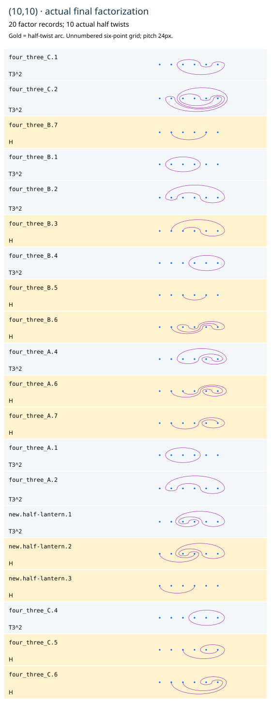

# The imported (10,10) construction, completed from its exact source

[Follow the diagrams](10-10.html) · [PDF](10-10.pdf) · [Full certificate](10-10.json)

The requested work is now in this repository. Original source files and both
original sheets are copied byte-for-byte under
`../fibration-sources/planar-mcg-2026-10-30`, with a SHA256 provenance manifest.
The other project's master branch had no commits, so exact file hashes supply
the source pin. Ordinary builders and tests need only this repository.

## Use the original exact A, B and C blocks

The original A is the seven-factor (4,3) relation derived in [the preceding
chapter](4-3.md). In the old package's right-conjugation convention,

```
B = sigma4^-1 A sigma4,
C = sigma4^-2 A sigma4^2.
```

Every ordered factor is retained. Each block has disk product D5^2. Assemble
B,A,C, making21 records with total type(12,9) and product D5^6. This three-copy
assembly is a construction, not an equality between one and three copies.

Rotate the first seven-factor block right1, the middle left3 and the last
left2. These three independent cards start from the SAME21-factor input;
all three pairwise literal two-order certificates are retained. Rotate the
whole central B5 product right3. Every cyclic step keeps its full inverse-
prefix common word, raw free-word equality and independently known boundary
invariance. Centrality is used in B5 here, never assumed in B6 later.

The saved source pulls use24 external adjacent checks. Every actual crossing
is previewed at bound20, raw-reconstructed FIRST and then individually
normalized. Two actual equal-half pairs become adjacent and combine, making
19 records without changing the type(12,9) unit count.

## Add the sixth point and separate redraw from substitution

Embed this construction into six points by adding the new point on the LEFT.
The complete target is the sixth power of the five-point outer on2..6. It is
not central in B6; all earlier frames remain explicit. Embedding is labeled
as a context/construction change.

The actual merged pair individually matches the canonical ordered pair
(T56,T12) in the saved chart associated to
`(-3,4,5,5,4,3,1,2)`. No gathered product or unchanged neighbor is assumed.

First redraw ONLY the SAME T12 sphere curve as its complementary four-point
outer O3456, on its own step. The actual factor ID and power remain fixed.
The certificate retains the local discrepancy AND the FULL surrounding-word
discrepancy, exact marked-sphere actions and separately checked chosen+I.
This is a genuine sphere redraw; no disk equality is claimed for it.

On the NEXT step apply the exact DISK relation

```
T56 O3456 = T456^2 H34_routed H34.
```

Its full named proof is retained: standard three-point PC half lantern,
explicit internal cyclic common word, labeled parallel copy of the fifth
strand with every induced Q56 correction, one internal raw Hurwitz move, and
every individual actual input/output match. The routed half has the source's
3-to4 arc passing down through gap6. The entire canonical proof is transported
back to the actual local chart; it is not an applied global frame of all
surrounding factors. All17 outside actual records remain literal in these
last two operations.

The replacement changes the unit type from(12,9) to(10,10). The final20 actual
factors have identity marked-sphere action and separately chosen+I lift.
The replay has11 recorded steps/13 individual operations, because the first
step has three genuinely independent cards. Assembly is specified at the
start; internal named-rule checks are retained outside the24 external checks.
Local support peaks at16, total135, with21 rows. These are not global geometric
minimality, arc-intersection or whole-proof tangle bounds.

## The four drawing edits are preserved, not silently adopted

The other project later changed the half arcs at positions6,13,19,20 of its
starting drawing. They are four different disk classes. Using those edited
curves gives final homology

```
-36   83   83  -112
 -8   17   16   -24
-23   54   55   -72
 37  -83  -83   113
```

This is not+I. All21 original-versus-edited comparisons, complete faithful
meridian images and the first differing meridian for each changed arc are
retained. The original algebraic source still supports the SAME source pulls
and matching pair; that is the checked version used above. No finite-orbit
exclusion or invented isotopy is claimed.

The older October17 twenty-route transcription in `surface_diagrams.ten_ten`
is a THIRD, distinct source. Its nonclosure evidence, original routes, F7
clarification, lab, sessions and exports remain unchanged. This new completed
construction does not claim that the old dictated product was repaired by
Hurwitz moves or identified with a particular literature example.


