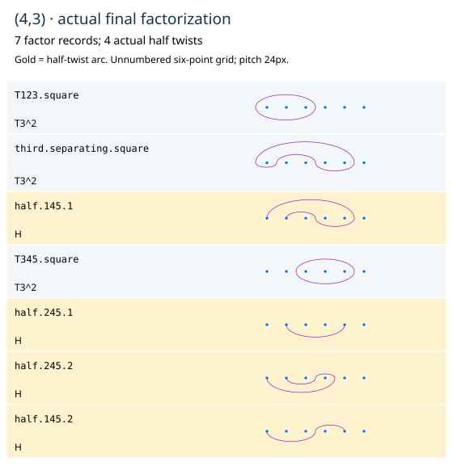

# A complete (4,3) derivation with its compensation visible

[Follow the diagrams](4-3.html) · [PDF](4-3.pdf) · [Full certificate](4-3.json)

Start with the four-point PC daisy. Three retained internal Hurwitz moves put
its actual petals in the imported source order. Parallel-copy the fourth
labeled strand to the pair45, using zero internal twist. Every generator is
replaced by its actual labeled block crossing. The copied labels return; no
ordinary puncture deletion or unchosen framed-half-hole convention is used.

Write Q=T45 and D=T12345. The complete cabling proof retains each pair
correction and yields the positive cabled relation

```
R = T123 T145 T245 T345 = D Q^2.
```

The precise conjugators are part of the certificate; the displayed point
sets alone do not define these terms. On formal full boundaries the residual
PC balance is(1,1,1,0,0); those first three inner corrections cap to marked
points. No individual half twist is assigned an unchosen hole framing.

Apply beta=sigma1 sigma2 sigma1 to R and choose the verified cyclic start of
that variant. Its product is again D Q^2. Concatenation gives

```
R R_variant = Q^4 D^2.
```

The SAME explicit positive Q^4 compensation is kept on the left of the target.
There are no negative twist factors. A raw-certified cyclic start makes two
pairs of ordinary triple roots adjacent. Their matched combines produce two
squared triples and two ordinary roots to be converted.

Apply the PC half lantern to the LATER root first. Its checked internal chart
changes by one inverse generator, retaining the actual parent and the pair
correction. The two half outputs individually match the source. Expose the
positive Q^2 correction first and carry it to the LEFT across only commuting
ordinary roots. Repeat for the other root. No half arc is crossed by these
ledger carries. All raw moves and their bounded complete context are retained.
The two corrections combine to the SAME Q^4 prefix on both sides:

```
Q^4 W_eight = Q^4 D^2.
```

Cancel that common prefix **from BOTH sides of the proved relation**. This is
explicit algebraic proof bookkeeping, not deletion of a twist from a fixed-
product fibration, a sphere move or a peripheral cap. The cancellation has its
own displayed step and complete before/after targets.

Five actual adjacent Hurwitz checks move the remaining roots into position.
The final matched combine makes the third squared triple. Every one of the
seven outputs individually matches the original imported A presentation.
There are four unit half twists and three squared triples, type(4,3), with
product D^2, separate marked-sphere identity and chosen+I lift.

The proof has15 recorded operations/15 external adjacent checks. Its complete
canonical daisy and half-lantern checks are retained separately, so this is
not a count of all atomic internal checks. Local support peaks at12, total42,
with at most10 rows. These are not arc/joint-minimum/whole-proof bounds.



The old drawing-only intermediate loops and inverse-correction sheet are
archived unchanged. The native derivation supplies their explicit positive
compensation proof and checks the later Hurwitz arrows. It runs without the
other toolkit installed. It does not replace the separate Xiao lab or assert
an unproved curve-by-curve identification with that lab or a framed section lift.
