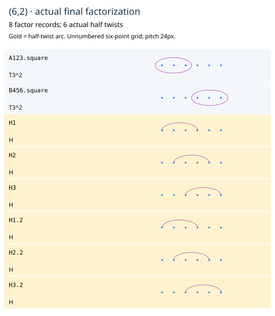

# A complete (6,2) derivation

[Follow the diagrams](6-2.html) · [PDF](6-2.pdf) · [Full certificate](6-2.json)

Let A=T123, B=T456, H=H14 H25 H36, and r=sigma5 sigma4 sigma3 sigma2 sigma1.
The three half twists are the exact band arcs from the imported source, with
all conjugators retained. The named block-rotation calculation gives

```
r^3 = A B H,       H A H^-1 = B,       H B H^-1 = A.
D6 = r^6 = (A B H)^2 = A^2 B^2 H^2.
```

These are full faithful B6 equalities, not just endpoint permutations. The
rotation is descending; replacing it by the ascending word does not give this
actual H. The complete six-meridian certificates are retained.

The graphical derivation has five recorded operations and eight external
adjacent checks. First replace D6 by its two explicit ABH packets. Move the
SAME three-half block down across the two actual roots, with the last half
crossing first for each neighbor. All six raw adjacent moves are reconstructed
and checked at support bound20 BEFORE application. Commute the returned A
across the two disjoint B copies, retaining both raw checks. Combine the equal
A copies, then the equal B copies. No negative factors, sphere substitutions,
strand deletion or extra half twists occur.

The final eight records are exactly the two squared triple twists and six
unit halves: type(6,2). They individually match the source factorization.
The trajectory has support maximum9, total54 and at most10 rows; those are
chart/presentation measures, not arc intersections or a joint minimum.

The final product equals the full six-point disk boundary twist. Its marked-
sphere action is identity and its chosen genus-two lift is separately +I.
This does not assert triviality in the disk braid group or in an unquotiented
spherical-braid group. Individual half twists that move strand6 are never fed
to a fixed-last-strand deletion/splitting operation; their full actions remain.



The native records and the exact original `six_strand_two_six_factorization`
source have been copied from the other project with a SHA256 manifest. This
certifies these particular curves and the displayed identity; an independent
identification with a literature curve chart or framed section lift is not
silently inferred from the type count.
